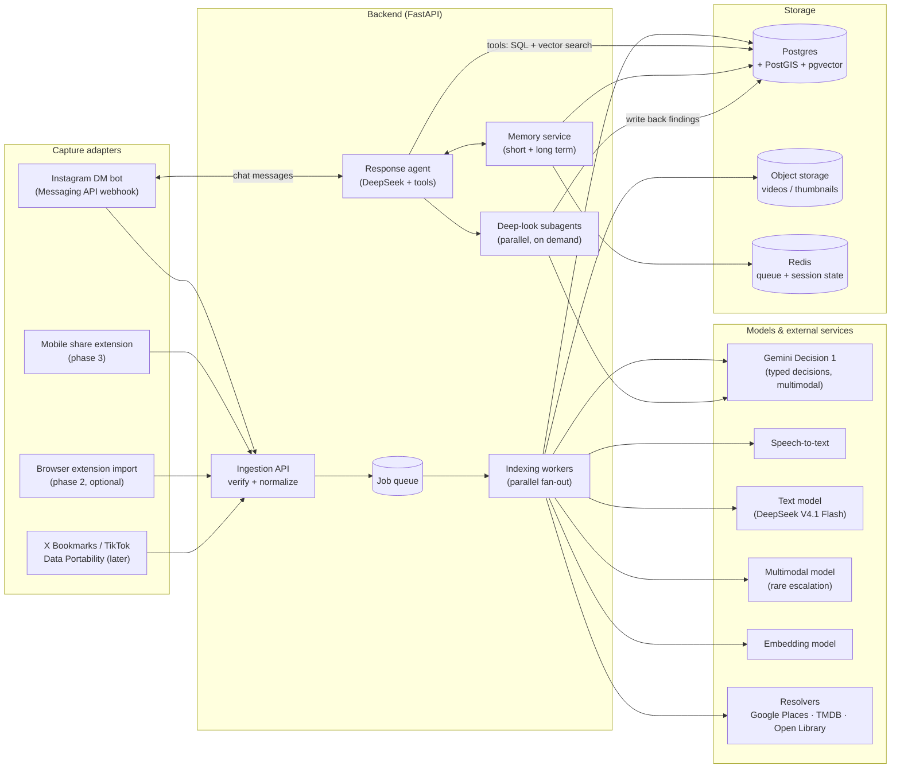
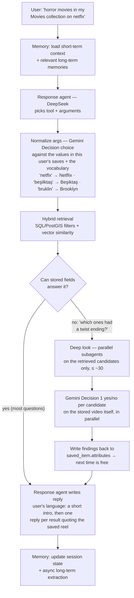
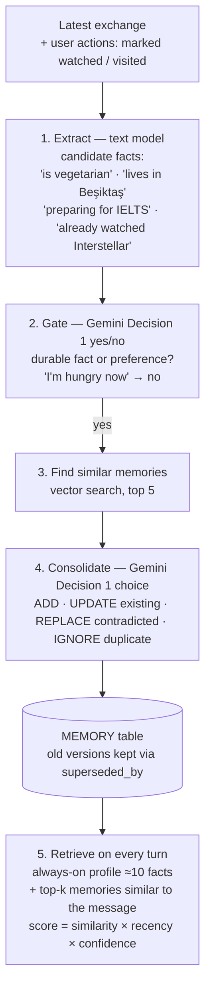
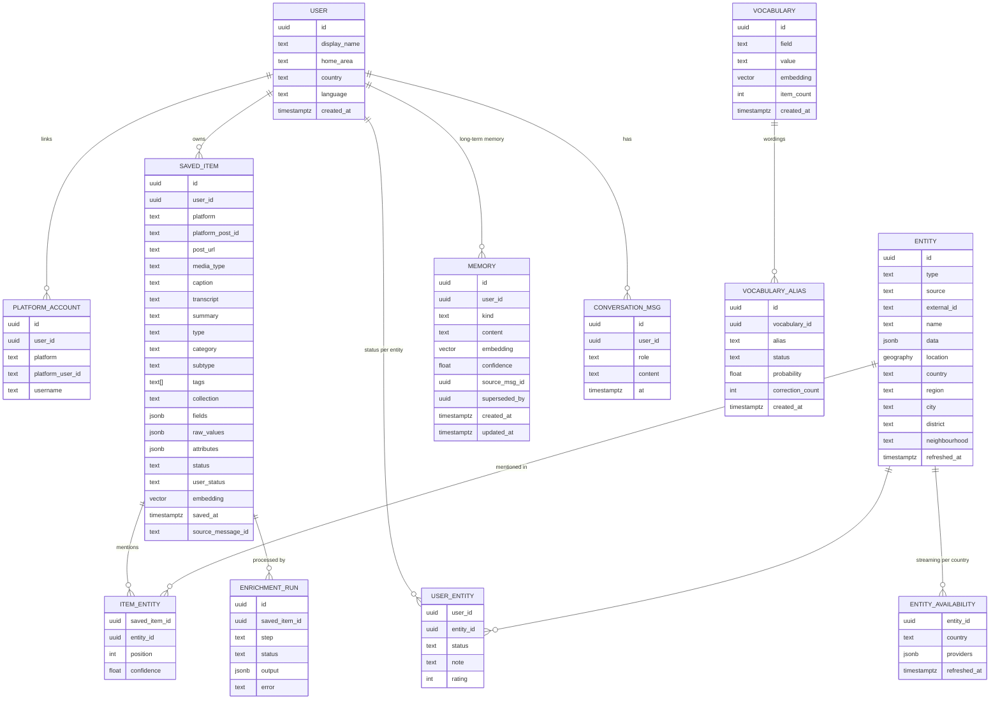

# Architecture: Saved-Posts Agent

> **Savely**: you save a post (Instagram first, then TikTok, X, Facebook…). The system works out **what it is**: a restaurant, a movie, a study tip, a recipe, anything. Then you can ask things like *"what restaurants did I save in Beşiktaş?"*, *"horror movies from my Movies collection that are on Netflix"* or *"the spaced-repetition tips I saved for studying"*.

## 1. Principles

1. **Capture where the user already is.** Sharing a post to the bot should take one tap, the same as tapping Save.
2. **Official integrations only on the server.** We never store a user's social-media password or log in as them. Grey-area import tools run on the user's own device, are opt-in, and are never required.
3. **One brain, many adapters.** Each platform is a small adapter that turns its input into a common `CaptureEvent`. Everything after that doesn't depend on the platform.
4. **Any kind of content.** Every saved item gets an open category and tags in plain words, so nothing is forced into a fixed list. Places, movies, books and the like are **built-in types** only where we add special behaviour such as a resolver (§3.4). New types can be added as config; the pipeline doesn't change.
5. **Anyone, anywhere, any language.** No city, country or language is built in. Values come from real saves through a growing vocabulary, places use Google Places' address fields for any country, and replies use the user's language (decision record 0005).
6. **Analyze once, search many times.** Videos are understood when they're saved, never when the user asks a question.
7. **Ask when unsure.** If we can't confidently identify something, the bot asks ("Is this *Kronotrop Bebek* or *Kronotrop Karaköy*?", "*Dune* (2021) or *Dune: Part Two*?") instead of guessing.

## 2. System overview



## 3. Components

### 3.1 Capture adapters
Every adapter outputs the same object:

```python
class CaptureEvent(BaseModel):
    user_id: UUID              # our user
    platform: Literal["instagram", "tiktok", "x", "facebook", "youtube"]
    source: Literal["dm", "share_ext", "browser_import", "api"]
    post_url: str | None       # no public link for collection-saved reels and DM-shared photo posts
    platform_post_id: str | None
    caption: str | None        # if the platform sends it
    media_url: str | None      # video or image URL if provided
    media_type: Literal["reel", "post", "carousel", "video", "tweet"] | None
    collection_hint: str | None  # e.g. "Movies", from an import or the user's message
    source_message_id: str | None  # the DM's message id (mid), so answers can reply to it (§3.5)
    received_at: datetime
```

**Instagram DM bot (Phase 1).** The user shares a post or reel by DM to our Instagram professional account (`@savedagent`). Meta then sends a `messages` webhook:
- Reels arrive as an `ig_reel` attachment with `title` (the caption), `url` (the reel's public page) and `reel_video_id`.
- Posts arrive as `ig_post`, with a signed link to the image instead of a public link. Meta is replacing the old `share` type during 2026, so the adapter accepts both.
- A reel saved into a collaborative collection that the bot belongs to arrives as an `unsupported_type` attachment with only a signed link to the video file (decision record 0003).
- A signed link is the `media_url`, never the `post_url`.
- Plain text messages ("what's in Beşiktaş?") are routed to the **Response agent**, not the indexing pipeline. A text sent right after a share may instead name that post's collection ("Food", "for my Movies collection", "Filmler", "勉強"); then it is stored as the item's `collection_hint` and not answered. **The decision model decides** which one it is, in the chat worker, never in the webhook (decision record 0018). `COLLECTION_HINT_WINDOW_SECONDS` is only an upper bound: a text sent later is chat, with no model call. Below `COLLECTION_HINT_MIN_PROBABILITY`, when the call fails, or when it takes longer than `COLLECTION_HINT_DECISION_TIMEOUT_SECONDS` (at most half of the chat run's deadline, so there is time left to answer), the text is chat too: a missed label costs little, a swallowed question looks broken. The share and the text are two separate webhooks (decision record 0009).
- A collection the user named is confirmed in their language: in the save confirmation when it was not sent yet ("Saved as café · in Food"), otherwise in one short message of its own ("Saved to Food"), sent once. When the item's indexing fails for good, so no save confirmation comes, that short message is sent by the chat worker or, if the label came first, by whatever marks the item `failed` (decision record 0018).
- Every share keeps its message id (`mid`) as `source_message_id`. Answers later reply to that exact message, so the saved reel appears again in the chat (§3.5, decision record 0004).
- Replies use the Send API. Instagram only allows replies within **24 hours** of the user's last message. That's fine for chat, but it means the bot **cannot send proactive alerts**, which need the mobile app (Phase 3).

**Browser extension import (Phase 2, optional).** Adds a "Sync my saved" button on `instagram.com/<me>/saved`. It reads collections (with their names: Food, Movies, Studying…) and post links from the page in the user's own logged-in session, at human speed, and sends them to `/import`. This is a grey area under Instagram's Terms, so it's opt-in and runs only on the user's device.

**Mobile share extension (Phase 3).** The iOS/Android share sheet works the same way from Instagram, TikTok, X and YouTube. It's our universal connector across platforms.

### 3.2 Ingestion API
- `GET /webhooks/instagram`: Meta's verification handshake (`hub.mode`, `hub.verify_token`, `hub.challenge`).
- `POST /webhooks/instagram`: verify the `X-Hub-Signature-256` HMAC, check for duplicates by message id, map to a `CaptureEvent` or a chat message, **enqueue, and return 200 immediately**. Meta retries slow webhooks.
- The first message from an account creates its `USER` and `PLATFORM_ACCOUNT`.
- The webhook stores the `SAVED_ITEM` as `pending` and queues a job on Redis (`arq`): `index_saved_item` for a new item, `answer_chat_message` for a text, each on its own queue so a worker only takes the jobs it can run. Jobs carry only ids; the caption, text or media link they work on is kept with the user's ingestion state in Redis, which "delete my data" erases. Each job has an id made from the item or the text's receipt, so a webhook that is delivered twice is queued once. If the database or the queue fails, the webhook is answered with an error and Meta delivers it again (decision record 0009).
- Each text gets a receipt by message id, kept before its job is queued, so a repeated delivery is handled the same way and queued once. Every text gets an `answer_chat_message` job. A text sent within `COLLECTION_HINT_WINDOW_SECONDS` after the user's last share before it, whose item has no collection yet, is bound to that share's item (a tap on one of the bot's buttons never is), including a repeated share of a post that is already saved, also when a later share was delivered first; its route is left `undecided`. Any other text is `chat`. The webhook calls no model.
- The chat worker settles an `undecided` route once, before the response agent runs: one yes/no question to the decision model (`ROUTING_PROMPTS`), compared with `COLLECTION_HINT_MIN_PROBABILITY`. Under the user's row lock it writes the decision to the receipt and, for a hint, the item's collection; every later try, every overlapping try and every repeated delivery follows the receipt, and sets the collection again first in case the write that decided it rolled back. The indexer reads the collection and marks its save confirmation as started under the same lock, so the worker knows whether the confirmation still says the collection or it must send its own (decision record 0018).
- `POST /import`: batch endpoint for the browser extension and data-export uploads.
- Upsert by `(user_id, platform, platform_post_id)`, so sharing the same post twice doesn't create a duplicate. An item without a post id (a reel saved into a collaborative collection) is stored once per `(user_id, source_message_id)`, so a webhook that Meta delivers twice doesn't create one either. Two saves of the same reel are two messages, and stay two items (decision record 0007).

### 3.3 Indexing pipeline (heavy work, runs once per saved item)

**Rule: videos are analyzed once, when they're saved or imported, never when the user asks a question.** Questions are then answered from the index in milliseconds, at almost no cost, with the same answer every time.

**Parallel fan-out.** A single share is processed as soon as it arrives. A bulk import (e.g. a 500-reel collection) is split into batches across N parallel workers (e.g. 10 × 50). The provider's rate limits set the maximum speed. The bot sends progress updates ("Imported 230/500… 61 places, 40 movies, 25 study posts so far").

```mermaid
flowchart TD
  A[CaptureEvent] --> B[1. Fetch<br/>caption, location tag, media URL<br/>→ download thumbnail + video now, links expire]
  B --> C[2. Classify + route — Gemini Decision 1 on the video, one pass<br/>choice: built-in type — place · movie/series · book · … · none of these<br/>yes/no: is it a list of several things?]
  C --> AT{Does the file have<br/>an audio track?}
  AT -- "no: no speech" --> X
  AT -- yes --> T[3. Speech-to-text, always<br/>empty or nearly empty transcript = no speech]
  T --> X[4. Extract — text model<br/>caption + location tag + transcript<br/>→ category + tags in open words · entity candidates<br/>· the type's fields · summary]
  X --> NV[Normalize open values against the vocabulary<br/>exact hit → reuse · otherwise privacy gate,<br/>then decision model: an existing value or 'new']
  NV --> X2
  X2{Type needs an entity<br/>and none was found?}
  X2 -- "yes (e.g. silent reel)" --> V[Escalate: multimodal generative model<br/>watches the video itself]
  V --> F
  X2 -- no --> F[5. Resolve — the type's resolver<br/>place → Google Places · movie → TMDB · book → Open Library<br/>types without a resolver and open categories → none]
  F --> G[Gemini Decision 1 choice:<br/>video + resolver candidates → which one? + confidence]
  G --> G2{Confident?}
  G2 -- yes --> I[6. Store entity/entities + link to saved item]
  G2 -- no --> J[Ask user in DM<br/>with top 2–3 options]
  J --> I
  I --> K[7. Embed summary + transcript<br/>+ confirmation DM that says how it was saved:<br/>'Saved: Inception 2010 · Sci-fi · on Netflix 🎬'<br/>'Saved as 🚗 car review · BMW M3']
```



Notes:
- **Why two model types.** Gemini Decision 1 only gives typed answers (yes/no, choice, score, with calibrated probabilities). It can't write text or pull an open-ended name like "Kronotrop" or "Inception" out of a video. Because it **takes video directly**, though, it makes the fixed decisions while looking at the video (steps 2 and 5).
- **Video → text first, then a cheap text model.** We turn speech into text and let a cheap text model (DeepSeek V4.1 Flash) do the extraction. The video model is only an escalation, for posts where the caption and speech weren't enough.
- **No OCR.** Silent reels whose only information is a text overlay go to the video-model escalation. We track the escalation rate. If it's high for some types (common for food reels), revisit this.
- **One pass, many questions.** Each decision call sends the video once with all its questions. Google says it handles up to 1,000 questions per pass.
- **List posts.** "5 movies to watch this weekend" or "3 cafés in Kadıköy" is one post with **several entities**. The extractor returns a list, and each entity is resolved and linked to the same saved item.
- **The user's collection is a hint, not the type.** A "Food" collection can hold a restaurant and a recipe. The collection name is stored and used as a search filter and as a hint during classification, but the type is decided per post.
- **Speech routing** (decision record 0008). A file with no audio track has no speech, and speech-to-text is skipped. A file with an audio track always goes to speech-to-text, even when the caption or the location tag already names the entity. If the final transcript is empty or nearly empty, the item has no speech. **Nearly empty** means fewer than `TRANSCRIPT_MIN_SPEECH_CHARACTERS` letters, digits and combining marks, in any script; spaces, punctuation and symbols such as ♪ don't count, and words aren't counted, because many languages don't separate them with spaces. **A provider error is not silence:** if no model produced a transcript, or the default model heard nothing and the fallback then failed, the step fails and the job runs again. No model's "has speech" answer decides the route, and the decision model isn't asked: in our tests, for videos with no audio track, the decision model gave speech probabilities of up to 0.86 and the video models claimed speech.
- **Reels shared by DM are indexed from their caption only** (decision record 0012). Meta sends no video file for them (record 0002), and nothing is read from a post's page, so they get no speech-to-text and no escalation. Reels saved into a collaborative collection and `ig_post` images come with a file link and go through every step.
- **Resumable steps.** One `arq` job per item runs the steps. Each step's result is written to `ENRICHMENT_RUN` when it finishes, so a job that runs again after a failure continues where it stopped. A failure to read the payload or the item at the start is retried the same way. Each run has one budget, `INDEXING_RUN_DEADLINE_SECONDS`, which starts before the payload is read and covers the start and every step. A run that passes it stops itself, records where it was within `INDEXING_FAILURE_RECORDING_SECONDS`, and runs again; arq's own, longer job timeout is only a backstop. An item gets `INDEXING_MAX_TRIES` runs in all, a hard cap counted on the item (`indexing_attempts`) across requeues and checked under the owner's lock before a run starts; the last marks it `failed` as well as it can within its recording deadline. A media tool that times out or is cancelled is stopped (SIGTERM, then SIGKILL) and reaped within a bound, also if a cancellation arrives during that clean-up.
- **The stuck-item sweeper; Postgres is the source of truth.** An arq cron in the indexing worker runs every `INDEXING_SWEEP_INTERVAL_SECONDS`. It finds `pending` or `enriching` items that no job has worked on for `INDEXING_STALE_AFTER_SECONDS` (validated to be longer than a live job can stay silent) and handles each under the owner's row lock with `SKIP LOCKED`, paging past locked owners so they never hold up other users: with tries left and its payload still in Redis it is queued again under its usual job id, otherwise it is marked `failed`. It repairs whatever a job couldn't write (a locked row, a database or Redis outage, a dead worker), needs no Redis job to survive, and never sees deleted users (decision record 0012).
- **Stored media.** A video is kept as a 360p MP4 with its audio track and a still picture, an image as a smaller JPEG, in object storage (a local folder, `MEDIA_STORAGE_DIR`, in development), per user and item. "Delete my data" removes them.
- **Prompts** live in `app/pipeline/prompts.py`, in one `PipelinePrompts` object with a version. The version is stored with each step's result, so an evaluation names the wording it scored. A wording change gets a new version and is scored on the eval set.
- **The confirmation** is written in the user's language. Until it is known (or while that language has no wording), it is written in English. It names the collection the user gave the post, when they did before it was sent (§3.1, record 0018).
- **Cost and escalation** are logged per item: its type, whether it was escalated, and the charges of its model calls.
- **Any language, anywhere.** Captions, speech and replies can be in any language, and places can be in any country. Nothing in the pipeline assumes a language, a city or a country (decision record 0005).

### 3.4 Content types, open categories and the vocabulary
Savely works for **anything a user saves**, so it never forces a post into a fixed list (decision record 0005).

**Every saved item gets an open `category` and tags**, written by the text model in plain words: "restaurant", "sci-fi movie", "car review", "skincare routine", "guitar lesson". They are searchable at once ("show my car videos"), and the confirmation DM says how the item was saved, so the user can correct it ("no, it's a travel video").

**Built-in types exist only where we add special behaviour:** a resolver that finds the real thing, extra fields, or special filters. A post that fits none of them isn't squeezed into the nearest one: it keeps its open category and tags, and is still fully searchable by meaning. When an open category keeps coming up across users, it can be promoted to a built-in type as config, without changing the pipeline.

| Built-in type | Extracted by the text model | Resolver → enriched fields | Extra search filters |
|---|---|---|---|
| **place** (restaurant, café, bar, shop, attraction…) | venue name(s), area hints, cuisine | Google Places → country, region, city, district, neighbourhood (whatever the address has), coordinates, hours, price, rating | area at any level, near me, open now, cuisine, price |
| **movie / series** | title(s), year hints | TMDB → year, genres, runtime, rating, **where to stream in the user's country** (TMDB watch providers) | genre, year, streaming platform, watched / not watched |
| **book** | title(s), author | Open Library / Google Books → author, genre, pages | genre, author, read / not read |
| **study** (tips, tutorials, explanations, courses) | subject, topic, key points, resources mentioned | none | subject, topic, format, exam or course |
| **recipe** | dish, main ingredients, time, diet | none | ingredient, cuisine, time, diet |
| **product** | product, brand, price mentioned | none (later: shopping links) | brand, price |
| **workout** | exercise, muscle group, equipment | none | muscle group, equipment, duration |
| *(no built-in type)* | open category, tags, summary | none | category, tags, plus meaning search |

**Phase 1 built-in types:** place, movie/series and study. Everything else uses an open category from day one.

**Open values, kept consistent: the vocabulary.** Category, tags, cuisine, genre, subject, exam, format, subtype and similar fields are **open text**; there are **no value lists in code**. To stop "korean", "Korean food" and "Kore mutfağı" becoming three values, each new value goes through the **vocabulary**, a shared table that grows from real saves:
1. The text model writes the value in its own words. The item keeps that wording in `raw_values`.
2. **Exact hit (no model call):** if the wording, lower-cased and trimmed, equals a canonical value or a **verified** alias of the same field, that value is reused. This is the only shortcut.
3. **Privacy gate:** any other wording must pass the gate (below) before it can touch the shared vocabulary. If it fails, the item keeps the wording as written, for this user only.
4. **Match or new:** embedding search finds similar values in the same field, and Gemini Decision 1 picks one of them or **"new"**. A nearby vector is only a candidate, never a match on its own.
   - **Match:** the item uses that value, and the wording is stored as a **candidate** alias.
   - **New:** a new canonical value is added.
5. A candidate alias becomes **verified** when the decision model has matched it to the same value with high confidence (`VOCAB_ALIAS_MIN_PROBABILITY`) for at least `VOCAB_ALIAS_MIN_USERS` different users, or when we confirm it in eval review. Only verified aliases count for the exact hit in step 2.

Values are stored in one canonical form (English, lower case) with aliases in any language. The extraction prompt asks the text model for open values in English, lower case, so a new value is the item's own wording, trimmed, with runs of white space made one space, and lower-cased; there is no translation call. Aliases are stored and compared in the same form, so a question in Turkish, Spanish or English finds the same items. Search filters offer the values that **exist in this user's saves**.

**Privacy gate: only generic words are shared.** The vocabulary has no link to any user and is used for everyone's normalization, so nothing personal may enter it, as a canonical value or as an alias:
- Code checks first: text with an @handle, URL, email address or phone-like number, or longer than `VOCAB_MAX_VALUE_LENGTH`, is rejected.
- Then Gemini Decision 1 yes/no: "Is this a generic word or phrase that could describe anyone's save, with no name, handle, contact or address of a private person, and nothing that describes the user themselves ('my diagnosis', 'my ex', 'grandma Ayşe's recipe')?" Only a confident yes (`VOCAB_PRIVACY_MIN_PROBABILITY`) passes. Uncertain counts as no.
- Rejected wording stays on the user's own item (as its category, tag or field value), is still searchable by that user, and is deleted with "delete my data". It never becomes a candidate for anyone else.

**Corrections move one item; synonyms need evidence.**
- When a user corrects an item ("no, it's a travel video"), **only that item changes**: its category becomes "travel video", through the same steps as above. "Car review" and "travel video" are **not** made synonyms, and no other item, the user's or anyone else's, is touched. Values the user sets by hand are marked as such in `raw_values` and are never re-normalized.
- The correction is counted against the alias that produced the wrong value. A candidate alias that gets corrected is not verified. A verified alias that collects corrections from several users is flagged for review (`VOCAB_ALIAS_REVIEW_MIN_USERS` different users, counted from the corrected items' normalize-step provenance, so one user's repeated corrections count once; record 0015, Q4).
- **Undoing a wrong alias:** we mark it `rejected`, which stops future matches. Only the items that were matched through it (recorded in their `ENRICHMENT_RUN` normalize step) are re-normalized from their own `raw_values`. Items the user corrected by hand keep the user's choice, also when the correction arrives while the models are working: the result is applied under the owner's lock, only where the item's wording and provenance haven't changed.

**Places are global.** Location fields come from Google Places' address components for any country: country, region or state, city, district, neighbourhood, plus coordinates. "Restaurants in Beşiktaş", "cafés in Brooklyn" and "bars in Shibuya" work the same way. A filter can match any of those levels. Until a mention is linked to a place (the resolver is Phase 2, §8), the area filter reads what the reel said instead: the levels of the mention's area hint, so "show me the reels I saved in Kadıköy" works without Maps data (decision record 0017).

**Streaming platforms differ by country**, so they're stored per movie **and** country in `ENTITY_AVAILABILITY` (§4), from TMDB's watch providers. Each row has its own `refreshed_at`, so refreshing a movie for a user in the US never changes what a user in Japan sees. A row is fetched when a user in that country saves or asks about the movie, and refreshed when it's older than `AVAILABILITY_MAX_AGE_DAYS`. Search and replies use the asking user's `country` (from their profile, or asked once). Provider names come from TMDB; there is no platform list in code. Each row stores `{"<offer kind>": ["<provider name>", …]}` with every TMDB offer kind; a title is "on" a platform only when it's watchable there without paying extra (`flatrate`, `free` or `ads`), while `rent` and `buy` are kept for replies (decision record 0014).

### 3.5 Answering questions (light work, every message)

The **response agent** (DeepSeek V4.1 Flash) never searches by itself and never watches videos. It understands the message, calls tools, and writes the reply. The tools do the searching. Subagents only run for the rare questions the index can't answer.



**Hybrid retrieval (this is our RAG):**
- **Structured filters** for hard facts: collection, type or open category, tags, and the type's filters (an area at any level, genre, streaming platform, subject…), plus distance (`ST_DWithin`) for places. Exact, fast and free. Filter values are normalized against what exists in the user's own saves, never against a fixed list.
- **Vector search** for fuzzy requests: "cozy date-night place", "that mind-bending sci-fi movie", "the video explaining recursion simply". These match the embeddings of what was said and summarized in each post.
- The two are combined: filter first, then rank by similarity. Long-term memories also affect ranking (§3.7).
- **Filter normalization** (decision record 0014) maps each value the user wrote to one in **their own** saves: their collections, categories, tags, the type's field values, the areas of their places, and the streaming providers of their titles **in their country**. An exact hit (one of their values, or a canonical value or verified alias of the vocabulary, compared trimmed and lower-cased) needs no model call. Otherwise their values are ranked by meaning (vocabulary embeddings) and spelling, values the wording was rejected as an alias of are left out, and Gemini Decision 1 picks one or "none of these" above `FILTER_NORMALIZATION_MIN_PROBABILITY`. With no match the wording is kept and L2 relaxes the filter. Normalization never reads another user's items and never writes to the vocabulary.
- **Where a filter reads its values** is declared by the content type (`FilterSource`), and all of a search's type filters must hold on the **same** mention (`fields.entities[i]`), so two venues or titles of a list post can't each satisfy half of them. A value describes the whole item only when the type's schema has a top-level field for it (a study post's `subject`). Any other value belongs to one mention, never to the list of all mentions' values at the top of `fields`. **A mention with a linked entity** (`item_entity.position` = its index) is judged by the entity's verified data: the key named after the filter in `entity.data` or in its own mention, an area by the entity's address levels, near by its location, streaming by `entity_availability` joined on `(entity_id, asking user's country)`, watched by the asking user's `user_entity.status`. **A mention with no linked entity** is judged by what the post said: a value filter (a place's `cuisine`) by the mention's own key, an area by the parts of the hint named by the filter's `mention_field` (a place's `area_hint`, split on any script's commas and semicolons: "Kadıköy, İstanbul" matches "Kadıköy" and "İstanbul"); filters that need an entity (near, streaming, watched, open now) never hold for it. So once a resolver links an entity, its data wins for that mention and its hint is no longer read (decision record 0017). The country is an explicit argument of the search; without it a streaming filter is refused, so the agent asks once. A missing or stale (`AVAILABILITY_MAX_AGE_DAYS`) row for that country is returned as an availability gap for the resolver to fetch; another country's row never stands in for it.

**Tools available to the response agent:**

| Tool | What it does |
|---|---|
| `search_items(collection?, type?, category?, tags?, filters?, text?, platform?, saved_after?)` | Hybrid search. `filters` is checked against the type's fields (e.g. `{"area": "Beşiktaş"}`, `{"area": "Brooklyn"}`, `{"genre": "horror", "streaming": "Netflix"}`, `{"subject": "maths"}`); `category` and `tags` work for every item (e.g. `category="car review"`) |
| `near(lat, lng, radius_m, category?, tags?, text?, open_now?)` | PostGIS search around a point, for the types with a location filter (places only) |
| `deep_look(item_ids, question)` | Fans out parallel subagents (see diagram) for questions the index can't answer |
| `get_item(item_id)` | Full details: open values with their paths, entity info and links, original post link, streaming in the user's country |
| `update_item(item_id, path, value)` | Fix one open value ("it's a travel video"). Changes only this item and never adds a synonym (§3.4). Re-resolving an entity ("no, it's the Bebek branch") and notes come with the resolvers (SAV-15) |
| `set_status(item_id, status, entity_position?)` | Mark the item's place or title as visited / watched / read / done, or "want to" (`USER_ENTITY.status`); `entity_position` picks one of a list post's entities. An item with no entity (e.g. a study post) keeps its status on the item itself (`SAVED_ITEM.user_status`), deleted with it (record 0015, Q6) |
| `set_profile(home_area?, country?)` | Keeps where the user lives and their country when they tell it ("I live in Beşiktaş"), on the `USER` row; the model asks once when a question needs one it doesn't know (record 0016) |
| `resolve_choice(item_id, option)` | Handles the user's answer to a "which one?" question (with SAV-15's pending choices) |
| `request_data_deletion()` | "Delete my data", in any words or language: the answer becomes a fixed confirmation question in the user's language. The request becomes confirmable only once that question was delivered, until `DATA_DELETION_CONFIRM_SECONDS` after sending it began (record 0016, owner decision 2) |
| `confirm_data_deletion()` | Deletes everything of the sender only when all of these hold, enforced in code: a delivered question, this is the **next** message (ingestion numbers every message a user sends in the order it arrives, once per platform message id, and the request waits for the number after the last one before the question was sent; only that message's turn takes it out, so "no", a share or any other message in between cancels it, whatever order the jobs run in), the message is a tap on the question's **"Yes, delete" button** (its fixed quick-reply payload, which the adapter reads and the chat worker turns into `deletion_confirmed`; a typed "yes" shows the question again), and the deadline, checked right before erasing and again by the eraser once it holds the user's row lock, which it may have to wait for. A successful erasure ends the turn with the fixed "done" DM, prepared in the user's language before, sent to the platform id read before the deletion |
| `list_memories()` / `forget_memory(id)` | "What do you remember about me?" / "Forget that" (§3.7) |

**How results are shown: the saved reels come back.** When an answer lists saved items, the bot sends a short intro ("3 places in Beşiktaş from your Food collection 🍽"), then **one message per result that replies to the user's original share** (`reply_to.mid` = the item's `source_message_id`). Instagram shows the saved reel or post quoted above the bot's line, e.g. "1/3 · Kronotrop, Beşiktaş · open now · Maps link". This works for DM shares and for saves into a collaborative collection alike (decision record 0004). If an item has no message id (for example a later browser import), the bot falls back to the post link, which Instagram shows as a preview card, or to the name and Maps or TMDB link. Results are capped (e.g. 5 per answer) with "show more" for the rest. Replies only work inside the 24-hour window, which is always true when answering a question the user just asked.

**The agent never touches the database.** Every tool is bound to the DM sender's `user_id` and country; no tool takes a user id from the model, and another user's item is answered like a missing one. The model's final answer is JSON (language, reply, notice, item ids, and an outcome that says whether the reply shows results) and is checked before it is sent: it may list only items the tools returned or the user's last results, it must carry a notice when search fell back (L1 "backup mode", L2 "broader results", or an incomplete search), a reply that says it shows results must list them, and it must fit in one DM. Calls that offer tools don't send the answer format, because the configured model skipped the tools when both were sent; the format is sent in a separate answer step, in which tools may not be called. The loop is capped at `AGENT_MAX_STEPS` model calls, and the last one is an answer step (decision record [0015](decisions/0015-response-agent.md), SAV-38 update).

Location for places in Phase 1: the user can type an area ("I'm in Beşiktaş") or share their location in the DM. Real "near me" alerts come with the mobile app.

### 3.6 Search fallback ladder
Normal search should answer almost everything. The fallback covers two different situations:
- **Error:** part of search is broken (vector index down, database timeout, embedding API error).
- **Empty or suspicious result:** search worked but found nothing, or the user says "that's not all of them".

"Nothing found" is often the **true** answer (you never saved a restaurant in that district), so we climb the ladder one step at a time instead of jumping to the expensive levels. We stop at the first level that answers.

| Level | When | What happens | Cost / speed |
|---|---|---|---|
| **L0 Normal** | Always first | Hybrid retrieval: SQL/PostGIS filters + vector ranking | Free, ~1 s |
| **L1 Degraded retrieval** | Vector search or embeddings fail | SQL filters + Postgres full-text keyword search on caption, summary and transcript | Free, ~1 s |
| **L2 Relax and catch up** | 0 or very few results | Loosen filters (a wider area such as the city instead of the district, related genres or subjects, drop secondary filters). Also include items **not fully indexed yet** (`pending`, `failed`, `needs_user`) | Free, ~1 s |
| **L3 Decision scan over text** | Still nothing, or the database is unreachable | **Gemini Decision 1 does the search temporarily:** it checks each item's stored text against the question ("is this a horror movie?") in batched, parallel calls | Cents, a few seconds |
| **L4 Decision scan over video** (last resort) | Items with no usable text (indexing failed) | Gemini Decision 1 on the stored videos themselves, **capped** (e.g. the 50 most recent), in parallel | Most expensive, ~5–10 s |

Phase 1 builds L0–L2 (`app/agent/search/retrieval.py`, decision record 0014). L1 is chosen when the query text can't be embedded or the vector query fails. L2 runs when L0 or L1 found fewer than `SEARCH_MIN_RESULTS` items: a district or neighbourhood of a linked place is widened to its city for linked places, while mentions without an entity keep matching the area as written, tags and the type's other filters are dropped (collection, type, category, platform, date, a "near" point and L1's keyword match stay), and items that aren't fully indexed are matched by any word of the query in their caption. The result names the filters it relaxed, so the reply can say so.

Rules:
- **Time budget:** about 10 s in total (`SEARCH_TIME_BUDGET_SECONDS`). Answer with what we have, and tell the user when results may be incomplete ("Search is in backup mode right now, so this list may be missing some items").
- **Self-healing:** anything found at L2–L4 is queued for re-indexing, so the next search finds it at L0.
- **Works without the database:** a per-user snapshot (JSON of each item's id, text fields and entity info) is kept in object storage and updated on every change. L3 can use it even if Postgres is down.
- **Don't let it hide bugs:** every fallback is logged with its level and reason, and we get an alert if L1+ happens often.

### 3.7 Memory
The agent has three kinds of memory:

| Layer | What it holds | Where | Lifetime |
|---|---|---|---|
| **Content memory** | Everything the user saved, indexed (§3.3) | Postgres | Permanent |
| **Short-term memory** | The conversation so far + the **working set** | Redis | ~24 h (matches Instagram's reply window) |
| **Long-term memory (LTM)** | Facts and preferences about the user | Postgres (`MEMORY` table + embeddings) | Until changed or deleted |

**Short-term memory** makes follow-ups work:
- The last ~20 messages go into the response agent's context.
- The **working set** is the last result list with numbers and the filters that produced it. That lets "the second one", "show more", "only the cheap ones" or "which of those are on Netflix?" refine the previous search instead of starting over.

How it is built (`app/memory/session.py`, decision record [0016](decisions/0016-short-term-memory-and-chat-worker.md)): three Redis keys per user (the history, the working set, and how far each answer got: being sent, sent, stored), all expiring `SESSION_TTL_SECONDS` after the last exchange. The working set holds the result ids in their numbered order, how many were shown, and each search behind them as its tool and arguments. The model sees the numbered list, which ones were not shown yet, and the searches; to narrow, it repeats the search with one more filter. An answer that lists no items keeps the last working set. The chat worker (`app/agent/worker.py`, `app/agent/chat.py`) loads all this before the response agent runs and stores the new exchange after the answer was sent, also as rows of `CONVERSATION_MSG`. It sends and stores one answer per sender at a time (a Postgres advisory lock of the sender), so the working set is always the list the user saw last, and only while holding the user's row (`FOR KEY SHARE`), which "delete my data" locks too, so an answer never reaches or recreates a deleted user; storing a sent answer is retried without sending it again, and a later try finds it through either store (the reply mark in Redis, or its `CONVERSATION_MSG` rows). A late store goes in its place: its messages are merged into the history by time, and it never replaces the working set or deletion question of an answer sent after it.

The **basic profile** is the `USER` row: `home_area` and `country` are set by the agent's `set_profile` tool when the user tells them, and `language` is the language of the user's last message, stored by the chat worker (the save confirmations use it). The home area is shown to the agent on every turn.

**Long-term memory: extract → gate → consolidate → retrieve** (Mem0-style). This runs **asynchronously after each reply**, so it never slows the chat.



How memory is used:
- **Ranking and filtering:** a vegetarian user gets vegetarian places boosted, movies already watched are hidden or moved down, and "for my exam" means the exam the user mentioned before (e.g. IELTS or the SAT).
- **Fewer questions:** "near home" resolves to the stored home area.
- **User control:** `list_memories` and `forget_memory` from chat, and everything is deleted with "delete my data". Sensitive categories (health, religion, etc.) are never stored. The gate rejects them.

### 3.8 Notifications (Phase 3)
- **Places:** the mobile app uses a geofence. Entering an area with N saved places that are open now triggers a push notification.
- **Movies/series:** "A movie you saved is now on Netflix" (TMDB watch-provider changes).
- Users can set rate limits and quiet hours.

### 3.9 Model roles
Every model sits behind a small provider interface (`generator.generate`, `classifier.decide`, `transcriber.transcribe`, `embedder.embed`). Each role is set in config, so models can be swapped and compared on our own labeled saves.

**All model calls go through OpenRouter** (`https://openrouter.ai/api/v1`, one key, `OPENROUTER_API_KEY`). The models below are first choices from small live tests; decision record [0008](decisions/0008-model-choices.md) has the measurements, and the evaluation set re-checks them.

| Role | Model | Why | Watch out for |
|---|---|---|---|
| **Fixed decisions:** content type, subtype/tags, is-list, which resolver candidate, vocabulary privacy gate + match-or-new, filter normalization, deep-look yes/no, memory gate + consolidation, whether a text right after a share names its collection (record 0018) | **Gemini Decision 1** (`google/gemini-decision-1`, launched 11 Nov 2026), through its own endpoint `POST /api/alpha/decisions`, not chat completions | Takes **text, images, audio, video and PDFs directly**. Typed outputs with calibrated probabilities, up to 1,000 questions per pass, ~50–100 ms model time (Google's figures), $0.10/M input tokens, output free | Brand new, and all benchmarks are Google's own. It does not decide whether a video has speech: it gave high speech probabilities for videos with no audio track (§3.3). Video is still token-heavy, so cost scales with video length. Do counting, maths and dates in code |
| **Speech-to-text** (every item with an audio track) | `microsoft/mai-transcribe-2`; fallback `openai/gpt-transcribe` when MAI returns an error or an empty transcript. No routing by language | Many reels say the name out loud, in any language. In our test MAI had the lowest error rate in four of six languages, and it returns the detected language with word and segment timestamps | Background music lowers accuracy. Keep MAI's language and timestamps. The GPT fallback returns none, so they are stored as unavailable, not left out. An empty or nearly empty final transcript means no speech |
| **Open-ended extraction** (entity names, type fields, summary) and **memory extraction** | `deepseek/deepseek-v4.1-flash` (the same model as the response agent), pinned to a provider hosted outside China | Names and summaries aren't fixed choices, so a decision model can't produce them. Text in, so it's cheap | Only as good as the caption + transcript it receives. The provider is a setting; which one, and where it is hosted, is verified with the model clients (SAV-10) |
| **Escalation:** watch the video when the text gave no entity | `google/gemini-2.5-flash`, with the video file as input | Catches what the caption and speech missed (silent reels with text overlays, recognisable storefronts or movie scenes) | Most expensive per call. Track the escalation rate per type. It also reported speech in videos with no audio track, so its speech answer is not used |
| **Response agent** (understands the message, calls tools, writes the reply) | **`deepseek/deepseek-v4.1-flash`**, pinned to a provider hosted outside China | Cheap, fast, good enough for tool calling + short replies | Check tool-call reliability and reply quality in several languages on our own tests. DeepSeek's first-party API is hosted in China, which is why user data goes to a pinned provider elsewhere |
| **Embeddings** | `openai/text-embedding-3-large` with `dimensions=1024` | Queries in one language must find captions in another | Check that every returned vector has 1024 dimensions. Re-embed everything if we switch models |

> **Fallback:** TypeSafe's **Jev** offers the same three question types and is cheaper ($0.042/M input), but its public docs describe text/structured input only. It's a good backup for text-only decisions (e.g. filter normalization, memory gate) behind the same `Classifier` interface.

**Evaluation set:** label ~100 of your real saves across your collections (type, entity, key fields) in Phase 1. Every model or prompt change is scored against it before switching.

## 4. Data model



- **`ENTITY`** is the real-world thing: a restaurant, a movie, a book. It's shared across all users, one record per `(source, external_id)`, e.g. `(google_places, ChIJ…)` or `(tmdb, 27205)`. Types without a resolver (study, recipe…) have no entity, and their info lives in `SAVED_ITEM.fields`.
- `location` and the address fields (`country`, `region`, `city`, `district`, `neighbourhood`) are only filled for places, from Google Places' address components for any country; any of them may be empty (PostGIS GIST index on `location`). Type-specific data goes in `data` (GIN index), e.g. genres and runtime for movies. Streaming providers are **not** in `data`, because they differ by country (see `ENTITY_AVAILABILITY`).
- **`ENTITY_AVAILABILITY`** holds TMDB watch providers for one movie or series in one country, primary key `(entity_id, country)`, with its own `refreshed_at`. Retrieval joins on the asking user's `country`. It holds no user data.
- **`ITEM_ENTITY`** is many-to-many, because one list post can mention several entities.
- **`USER_ENTITY.status`**: `want | done` (visited / watched / read), per user. Memory and ranking use it.
- **`SAVED_ITEM.user_status`**: `want | done` for an item that has no entity, such as a study post, set by `set_status` (record 0015, Q6). It is the user's own mark, separate from `status` (the indexing lifecycle), and is deleted with the item.
- `SAVED_ITEM.fields` holds the extracted type fields (e.g. `{"subject": "maths", "topic": "integrals", "format": "tutorial"}`). Open values inside nested objects, such as the cuisine of each place in a list post, are also listed once at the top under their vocabulary field (`"cuisine": ["korean barbecue", "specialty coffee"]`), where counting and filters find them. `attributes` holds facts learned later by deep look.
- `SAVED_ITEM.status` goes `pending → enriching → needs_user → done | failed`. `indexing_attempts` counts the indexing runs started, across requeues, and `indexing_updated_at` is the last time a job or the sweeper worked on the item; the stuck-item sweeper uses both (§3.3, record 0012).
- `SAVED_ITEM.source_message_id` is the Instagram message id (`mid`) of the DM or collection save that brought the item in. Answers reply to it so the saved reel shows again (§3.5). It's empty for items from imports.
- `SAVED_ITEM.category` is the open category the text model gives every item ("restaurant", "car review"), and `type` is the built-in type when one applies (empty otherwise). `subtype`, `tags` and open values inside `fields` use the vocabulary.
- `SAVED_ITEM.raw_values` keeps the text model's own wording for each open value before normalization, and marks values the user set by hand. It lets us re-normalize the item if an alias is rejected, and holds wording that failed the privacy gate. It is keyed by the value's path in the extraction: `{"entities.0.cuisine": {"field": "cuisine", "wording": "Kore mutfağı", "user_set": false}}`. It belongs to the item and is deleted with it.
- **`ENRICHMENT_RUN`** has one row per step of an item (`fetch`, `classify`, `transcribe`, `extract`, `normalize`, `embed`, `confirm`), with `status` `done`, `failed` or `skipped`; the `confirm` step is first written as `started`, together with whether the item's collection is in it, right before the confirmation is sent; an item that fails for good with a collection gets a `confirm` step that only confirms the collection (`after_failure`, record 0018). A failed step keeps an `error` with no content in it. The normalize step's `output` records, per path, the vocabulary field, the outcome (`exact_value`, `exact_alias`, `matched`, `new`, `private` or `undecided`), the value and alias it went through, and the match probability.
- **`VOCABULARY`** holds one canonical value per `field` (category, tag, cuisine, genre, subject, exam…) in English lower case, with an `embedding` for matching new wordings; `(field, value)` is unique. It's shared by all users, grows from real saves, and holds only wording that passed the privacy gate (§3.4).
- **`VOCABULARY_ALIAS`** holds other wordings of a value, in any language, each with a `status`: `candidate` (one decision-model match), `verified` (confirmed, used for exact hits) or `rejected` (a wrong match, never used again). `probability` is the best match confidence seen, and `correction_count` counts user corrections against it. Which items matched through an alias is recorded in their `ENRICHMENT_RUN` normalize step, not here.
- **"Delete my data"** goes through one eraser (`app/db/deletion.UserDataEraser`): first every store outside Postgres (ingestion's Redis state and queued jobs, a pending deletion request, short-term memory, stored media files), then the rows. If a store outside Postgres fails, Postgres is unchanged and the erasure can be repeated. Any new store of user data joins this eraser, which the chat worker builds (`app.agent.worker.build_toolbox`). The profile fields and `CONVERSATION_MSG` rows go with the `USER` row. It removes the user's items with their `raw_values` and enrichment runs, and lowers each value's `item_count`. The vocabulary keeps only gated, generic wording with no link to any user. A value no item uses any more can be cleaned up.
- Opening hours and ratings go out of date, so refresh `ENTITY.data` regularly (e.g. every 30 days), and also when the user asks for `open_now`. Streaming availability is refreshed per country (`ENTITY_AVAILABILITY`).
- **Dedupe keys on `SAVED_ITEM`** (decision record 0007). A user's item is stored once per `(user_id, platform, platform_post_id)` and once per `(user_id, source_message_id)`, whichever of the two ids it has. `platform_post_id` and `post_url` may be empty: a reel saved into a collaborative collection has neither. Every item has at least a post id, a message id or a post link, and a missing value is never stored as empty text. The message-id key tells **messages apart, not reels**: the same reel saved through two messages (saved twice, or saved and also shared by DM) becomes two items, because nothing in the payloads links them.
- Column-level choices (which columns may be empty, defaults, what is deleted with a user, index types) are in decision record 0007. The `MEMORY` table is created in Phase 2.

## 5. Tech stack

| Layer | Choice | Why |
|---|---|---|
| API | Python 3.12 + FastAPI | Async, good for webhooks, easy validation with Pydantic |
| Queue / workers | `arq` on Redis | Simple, async, retries built in. Redis also holds short-term memory |
| DB | Postgres 16 + PostGIS + pgvector | One database for location queries, JSON filters and semantic search |
| Models | All through OpenRouter: Gemini Decision 1 for decisions, MAI Transcribe 2 for speech (GPT Transcribe as fallback), DeepSeek V4.1 Flash for extraction + replies, Gemini 2.5 Flash for rare escalations, OpenAI `text-embedding-3-large` at 1024 dimensions | One provider and one key. See §3.9 and decision record 0008 |
| Media | ffmpeg and ffprobe (audio-track check, downscaled copies, stills, audio extraction), run as programs | Standard tool |
| Object storage | A local folder in development (`MEDIA_STORAGE_DIR`), behind a `MediaStore` interface | A hosted store comes with deployment |
| Resolvers | Google Places API (New) · TMDB API · Open Library / Google Books | Best coverage in each area. TMDB includes streaming availability per country |
| Hosting | Fly.io / Railway / Render to start | Public HTTPS URL for Meta's webhooks, and cheap |
| Local dev | Docker Compose + ngrok/cloudflared tunnel | Meta needs a public HTTPS webhook URL |

## 6. Repository layout

```
Savely/
  app/
    main.py                 # FastAPI app
    config/                 # settings from environment variables, one module per group
      base.py               # the API's Settings, shared constants and types
      models.py             # ModelSettings
      messenger.py          # MessengerSettings
      pipeline.py           # PipelineSettings
      retrieval.py          # RetrievalSettings
      agent.py              # AgentSettings
      chat.py               # ChatSettings: the chat worker and short-term memory
    logging_config.py       # structured (JSON) logging setup
    adapters/
      base.py               # CaptureEvent and ChatMessage
      instagram.py          # signature check, webhook parsing → CaptureEvent / ChatMessage
    api/
      webhooks.py           # Meta's handshake and the Instagram `messages` webhook
      imports.py
    ingestion/
      service.py            # stores captures, binds texts to the share before them, queues jobs
      text_routing.py       # the chat worker's decision: collection name or chat (record 0018)
      prompts.py            # the decision model's wording for that, versioned
      repository.py         # users on first contact, saved items, collection hints
      jobs.py               # job names, ids and queues (one arq queue per job name)
      session_state.py      # per-user state in Redis: payloads, text receipts, recent shares
      erasure.py            # erases a user's Redis state and jobs for "delete my data"
    models/
      base.py               # Generator / Classifier / Transcriber / Embedder interfaces
      errors.py             # error types of model calls
      factory.py            # builds every client from the settings
      fakes.py              # fake implementations of the interfaces, for tests
      openrouter/
        transport.py        # shared HTTP transport: key, timeouts, retries, error mapping
        routing.py          # which provider served a reply, from OpenRouter's routing metadata
        wire.py             # JSON helpers shared by the clients
      clients/
        decision.py         # Gemini Decision 1 client
        transcriber.py      # speech-to-text: default model + fallback
        chat_completions.py # Generator over chat completions, with the provider pin
        deepseek.py         # text model: extraction + response agent, pinned to one provider
        multimodal.py       # video model for escalations
        embeddings.py
    types/                  # built-in types only — one module each; items with no built-in type need none
      base.py               # what a type declares: ContentType, filters, schema bases, vocabulary marks
      registry.py           # the list of types, looked up by name
      place.py              # schema, filters, resolver
      movie.py
      study.py
    resolvers/
      google_places.py
      tmdb.py
      open_library.py
    pipeline/
      indexer.py            # runs the steps of one item, keeps each result, resumes after a failure
      worker.py             # the arq worker; parallel fan-out for bulk imports
      prompts.py            # every model prompt, in one versioned PipelinePrompts
      payloads.py           # reads the capture event of a job from ingestion's Redis state
      costs.py              # charges of model calls, per step and item
      steps/
        fetch.py            # download media before links expire
        classify.py         # decision model on the video: type, is-list
        transcribe.py       # speech-to-text (when the file has an audio track), near-empty rule
        extract.py          # text model with the type's schema; escalates to video model
        resolve.py          # type's resolver + decision-model candidate choice
        embed.py
        confirm.py          # the save confirmation DM
      media/
        tools.py            # ffprobe and ffmpeg
        storage.py          # MediaStore: object storage, a local folder in development
      vocabulary/
        store.py            # database work for the vocabulary and its counts
        normalize.py        # vocabulary: exact hit, privacy gate, match-or-new
        open_values.py      # paths of open values; extraction → item columns
        renormalize.py      # reject an alias and re-normalize only its items
        corrections.py      # a user's correction of one value of one item
      recovery/
        runs.py             # the item's row, status and steps in ENRICHMENT_RUN
        sweeper.py          # stuck-item sweeper: requeues or fails unfinished items, from Postgres
    agent/
      agent.py              # response-agent loop and answer checks
      tools.py              # search_items, near, get_item, update_item, set_status… (the only DB access)
      prompts.py            # versioned wording for the text model
      deletion_requests.py  # pending "delete my data" requests (Redis), with their deadline
      send.py               # sends an answer; a delivered deletion question becomes confirmable
      chat.py               # answers one chat message: memory in, agent, send, memory out
      worker.py             # the chat worker (arq, chat queue) and the eraser of every store
      deep_look.py          # parallel subagents + write-back
      search/
        retrieval.py        # hybrid SQL + vector search, fallback ladder, time budget
        query.py            # the search's arguments, checked against the content types
        conditions.py       # SQL/PostGIS/pgvector conditions and rankings
        saved_values.py     # the values in one user's saves, ranked by meaning among them
        normalization.py    # filter values → the user's own values (decision model)
        prompts.py          # versioned wording for the decision model
        fallback.py         # L1–L4 fallback levels, reasons, logging
      replies/
        messenger.py        # send DM replies, incl. replies that quote a saved reel (reply_to)
        templates.py        # fixed DM wording: confirmation, "which one?", progress, error, result line
        answers.py          # an answer: the intro, then one reply per result, with fallbacks
    memory/
      session.py            # short-term: history + working set (Redis)
      conversation.py       # the sender's profile and CONVERSATION_MSG (Postgres)
      longterm.py           # extract → gate → consolidate → retrieve
    db/
      models.py             # SQLAlchemy models for the tables in §4
      session.py            # the API's engine and session factory
      types.py              # column types for pgvector and PostGIS
      deletion.py           # "delete my data": the one eraser of every store, then the user's rows
      migrations/           # Alembic environment and revisions
  evals/
    labeled_saves.jsonl     # ~100 hand-labeled saves for model comparison
    normalization_cases.jsonl  # ~100 synthetic filter-normalization cases (SAV-30)
  extension/                # Phase 2 browser extension
  scripts/spikes/           # reproducible experiments behind decision records
  scripts/run_normalization_evals.py  # scores filter normalization on those cases
  tests/
    fixtures/webhooks/      # real (anonymized) webhook payloads
    fixtures/openrouter/    # model responses written from the provider's documentation
    live/                   # opt-in smoke tests that call the real models
    pipeline/, agent/, …    # tests in folders that mirror app/; the pipeline runs on fake models
  docker/postgres/          # Postgres 16 image with PostGIS + pgvector
  docker-compose.yml
  alembic.ini               # Alembic configuration
  Dockerfile                # image of the API and the indexing worker (with ffmpeg)
  Makefile                  # fmt, lint, typecheck, test, up
  pyproject.toml
  README.md                 # product front page for visitors
  assets/                   # the logo
  docs/ARCHITECTURE.md
  docs/development.md       # setup, run, test and how each part works
  docs/decisions/           # decision records
```

## 7. Platform reality check

| Platform | Official access to *saves*? | Our capture path |
|---|---|---|
| Instagram | ❌ No API for saved posts or collections | DM bot (official) → browser-extension import (optional) → share extension |
| Facebook | ❌ | Messenger bot, share extension |
| TikTok | ❌ In general. The Data Portability API may include favorites but needs approval and may be region-limited | Share extension. Check which countries the portability API covers |
| X | ✅ Bookmarks API (paid tier) | OAuth + periodic sync |
| YouTube | Partial (playlists via the Data API) | Share extension or playlist sync |

### Spike: collaborative collections
Instagram supports **collaborative collections**: you create a new collection, switch on *Collaborative*, and add a person or group chat from your DMs. Collaborators can't be added to an existing collection. So the bot account *could* be a collaborator, but:
- No official API exposes collections or sends events when something is saved to one, so the bot would be "in" the collection with no official way to read it.
- Reading it would mean logging into the bot account unofficially. At scale (one bot account in thousands of collections) that account would be banned quickly.

**Worth a one-hour test:** a collaborative collection is attached to a DM thread. Save a post to a collection shared with `@savedagent` and check whether a `messages` webhook fires. If it does, that's an official, zero-extra-effort capture path ("just save to your collection shared with the bot"). If not, we use DM sharing.

## 8. Roadmap

**Phase 0: setup and test (days)**
- Meta developer app, Instagram professional account for the bot, webhook pointed at a tunnel.
- Record real `ig_reel` / `ig_post` payloads as test fixtures.
- Run the collaborative-collection test.

**Phase 1: Instagram DM MVP (1–2 weeks)**
- Ingestion → indexing pipeline (decision model on the video → speech-to-text → text-model extraction) → confirmation DM.
- Built-in types **place, movie/series and study**, without resolvers: they are filtered by what the post said, e.g. a place's area hint and cuisine (decision record 0017). Everything else is saved with its open category and tags.
- Response agent (DeepSeek) with `search_items`, `near` (it finds places once the resolver gives them coordinates, Phase 2), `set_status`, hybrid SQL + vector retrieval, and fallback levels L1–L2. Asking "show me the reels I saved in Kadıköy" returns the saved reels.
- Short-term memory (history + working set) and a basic always-on profile (home area, country, language).
- Label ~100 real saves as the evaluation set.
- Runs in development mode, for your own account and testers.
- Not in Phase 1 (owner decision, 23 Nov 2026): Maps links, verified addresses, "near me", "open now", streaming availability and the "which one?" question. They need the resolvers.

**Phase 2: resolvers, old saves, deep look, full memory**
- Google Places and TMDB resolvers (SAV-15), with the "which one?" follow-up when we're not sure. Many places share a name, so match quality is tested before search relies on it. A linked entity's verified data then wins over the mention's hint for that mention; nothing in search changes.
- Browser-extension import and data-export ZIP import, using parallel fan-out indexing.
- `deep_look` tool with write-back.
- Full long-term memory (extract → gate → consolidate → retrieve), plus `list_memories` / `forget_memory`.
- Fallback levels L3–L4 and the per-user snapshot.
- More types: book, recipe, product, workout.
- Simple web app: map of places, movie watchlist, study library.

**Phase 3: mobile and more platforms**
- iOS/Android app: share extension (TikTok, X, YouTube), geofence and "now streaming" notifications.
- Meta app review, so other users can use the Instagram bot.

## 9. Risks and open questions
- **Meta app review** for `instagram_business_manage_messages` is needed before the public can use the bot. Plan screenshots and a privacy policy early.
- **Webhook payload changes:** `share` → `ig_post` is happening during 2026. Keep the adapter tolerant of both and keep a set of recorded test payloads.
- **Media URL lifetime:** CDN links in payloads may expire. Download right away and keep a downscaled copy (e.g. 360p) so deep look can re-watch it. Deleted together with the user's data.
- **No OCR:** silent reels with only text overlays must go to the video model. If the escalation rate is high, cost per item rises. Measure it in Phase 1.
- **Privacy:** store only what we need, never store sensitive categories in memory, and support "delete my data" from day one.
- **Cost per saved item:** aim for under about $0.01. Video-model escalations are the main cost risk.
- **Decision models are very new** (Gemini Decision 1 launched 11 Nov 2026; Jev in Sept 2026), and their numbers are vendor-reported. Use the probabilities with thresholds, measure them on our eval set, and keep a fallback classifier behind the same interface.
- **Model churn:** every model role is swappable through config. Never hard-code a provider in the pipeline or agent code.
